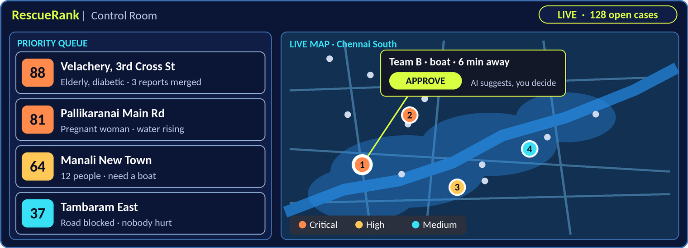
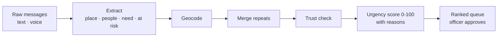

# RescueRank

**When thousands of help messages pour in during a flood, RescueRank helps rescue teams see who needs help first.**

  

Built for **K! Hacks 4.0** (CEG Tech Forum, Anna University) · Track: **Disaster Management**


---

## The problem

During floods and cyclones in Tamil Nadu, control rooms and volunteer groups get thousands of messages at once: phone calls, WhatsApp, social media and relatives' posts. They arrive in Tamil, English and Tanglish, as text and voice notes. Many are repeats, old posts or rumours, and people sort them by hand.

* In the 2015 Chennai floods, volunteers ran three WhatsApp groups to verify, log and escalate requests manually [[4]](#references).
* When Cyclone Michaung hit Chennai in December 2023, more than 40 cm of rain fell in 36 hours and helplines became unreachable for many people [[5]](#references).
* In Oct to Nov 2026, two cyclones (Arnab and Murasu) hit within a single week, and TNSDMA warned people not to spread unverified information [[6]](#references).

The result: an elderly person who needs medicine can get buried under dozens of copies of the same post.

## What RescueRank does

It acts as a **smart sorting desk** for disaster control rooms:

1. **Collect** distress messages (text or voice, any language mix).
2. **Understand** them: where, how many people, what is needed, who is at risk.
3. **Merge** repeat reports of the same incident into one case.
4. **Check trust**, and flag chain-forwards and unverified claims for review.
5. **Score** every case from 0 to 100 and **show the reasons** behind the score.
6. **Rank** the cases so officers see the most urgent first. A human always approves dispatch.



*Concept design of the responder dashboard. The dashboard is **not built yet** (see [Project status](#project-status)).*

## Try it in 60 seconds

```bash
git clone https://github.com/<your-username>/rescuerank.git
cd rescuerank
python -m venv .venv && source .venv/bin/activate     # Windows: .venv\Scripts\activate
pip install -r requirements-dev.txt
python -m rescuerank.demo
```

This runs the real pipeline on 11 synthetic messages in `data/sample_messages.json`. Output:

```text
RescueRank: 11 raw messages -> 9 cases

#  SCORE  BAND      PLACE                         REPORTS  FLAGS
------------------------------------------------------------------------
1  88     CRITICAL  Velachery, 3rd Cross St       3        
2  75     CRITICAL  Adyar                         1        
3  70     HIGH      Pallikaranai                  1        
4  64     HIGH      Mudichur                      1        
5  53     HIGH      Velachery                     1        
6  35     MEDIUM    Manali New Town               1        
7  29     MEDIUM    Sholinganallur                1        
8  5      LOW       Tambaram                      1        
9  3      LOW       Besant Nagar                  1        NEEDS REVIEW (low trust)

Why is 'Velachery, 3rd Cross St' ranked #1?  (score 88/100, CRITICAL)
  +15 Vulnerable person (elderly)
  +15 Medical condition (diabetic)
  +25 Water inside the home
  +23 Waiting 46 min
  +10 Group of 4
  merged 3 reports from 3 senders: m01, m02, m03
```

Notice that the three Velachery reports (one in Tanglish, one in English, one mixed) became **one case**, and that the forwarded rumour is flagged `NEEDS REVIEW` and ranked last.

## How it works



More detail, including what is built and what is planned for each stage, is in [`docs/architecture.md`](docs/architecture.md).

### The urgency score (explainable)

| Factor | Points |
|---|---|
| Vulnerable person (elderly, child, pregnant, disabled) | +15 |
| Medical condition (diabetic, heart/BP, pregnancy) | +15 |
| Life-threatening condition (oxygen/dialysis, injury) | +25 instead of +15 |
| Water inside the home / rising nearby / around the area | +25 / +15 / +10 |
| Waiting time | +0.5 per minute, max +25 |
| Group size | +2.5 per person, max +15 |

Total is capped at 100. Bands: **CRITICAL** 75+, **HIGH** 50 to 74, **MEDIUM** 25 to 49, **LOW** below 25.

> These weights are **example values** that show the idea. They are not validated by emergency professionals. A real deployment would tune them with disaster-management officers.

### Example

> *"Velachery 3rd cross st, ground floor la thanni vandhuduchu. 4 perr irukkom, paatiku sugar irukku. Help pannunga!"*
> (Water has entered the ground floor. 4 of us are here, and grandmother is diabetic.)

becomes: **Place** Velachery, 3rd Cross St · **People** 4 · **Need** rescue + medical · **At risk** elderly, diabetic · **Score 88, CRITICAL**.

## API

```bash
uvicorn rescuerank.api:app --reload
# interactive docs at http://127.0.0.1:8000/docs
```

```bash
curl -X POST http://127.0.0.1:8000/messages \
  -H "Content-Type: application/json" \
  -d '{"sender": "demo-1", "text": "Adyar, old man bedridden, oxygen low, water outside the house"}'

curl http://127.0.0.1:8000/queue
```

| Endpoint | What it does |
|---|---|
| `POST /messages` | Submit one raw message and get back the extracted facts |
| `GET /queue` | Ranked cases, each with its score and reasons |
| `POST /reset` | Clear stored messages (demo use) |
| `GET /health` | Health check |

## Project status

This is a hackathon prototype. Here is exactly what works today and what does not.

| Part | Status |
|---|---|
| Rule-based extraction (English, Tanglish, some Tamil script) | Working, tested |
| De-duplication (place + street + time window + wording) | Working, tested |
| Trust check (sender count, chain-forward detection) | Working, tested |
| Explainable urgency score | Working, tested |
| REST API (FastAPI) | Working, tested |
| WhatsApp / Telegram bot | Planned |
| Voice notes to text (Whisper) | Planned |
| LLM-based extraction | Planned |
| Real geocoding (OpenStreetMap) | Planned. Today: a small demo list of 14 Chennai localities with approximate coordinates |
| Embedding-based de-duplication (LaBSE) | Planned |
| Responder dashboard with live map (React + Leaflet) | Planned (concept image above) |
| Nearest-team suggestion (OSRM routing) | Planned |

## Run the tests

```bash
pytest
```

The tests check Tanglish and Tamil-script extraction, duplicate merging, the score arithmetic (including the 88-point example above), rumour flagging and the API.

## Project structure

```text
rescuerank/
  extract.py      # message text -> structured facts
  dedup.py        # same incident? merge repeats
  score.py        # explainable urgency score
  pipeline.py     # messages in, ranked cases out
  gazetteer.py    # demo list of Chennai localities
  api.py          # FastAPI app
  demo.py         # command-line demo
data/sample_messages.json   # synthetic test messages
docs/architecture.md        # diagram and stage-by-stage plan
tests/                      # pytest suite
```

## Limitations and responsible use

* **Not a replacement for officials.** RescueRank only ranks and suggests. People confirm every dispatch.
* **Weights are examples**, not validated. Do not use for real emergencies without expert review.
* **Rule-based extraction misses things.** Slang, spelling variants and unusual phrasing will fail. The planned LLM extractor is meant to improve this, and low-confidence cases should always go to a human.
* **Privacy.** Messages contain locations and health details. A real system needs consent, data masking, access control and a retention policy. The sample data here is entirely synthetic.
* **Rumours.** The trust check is a simple heuristic and will miss well-written false reports.
* **Geocoding is approximate** in this prototype.

## Roadmap

- [ ] WhatsApp / Telegram bot intake
- [ ] Whisper voice-note transcription (Tamil)
- [ ] LLM extractor behind the same `Extraction` interface
- [ ] OpenStreetMap geocoding with a local landmark list
- [ ] Embedding-based duplicate detection
- [ ] React + Leaflet dashboard with officer approval
- [ ] Nearest-team routing
- [ ] Tune the score weights with disaster-management officers

## Team

| Name | Role |
|---|---|
| SOWBARNIKA M | AI pipeline, backend, WhatsApp bot, urgency scoring |
| RAVIENA S | Dashboard, live map, demo data, pitch |

## References

1. Imran, Castillo, Diaz and Vieweg. "Processing Social Media Messages in Mass Emergency: A Survey." *ACM Computing Surveys* 47(4), 2015.
2. Alam, Ofli and Imran. "CrisisMMD: Multimodal Twitter Datasets from Natural Disasters." *ICWSM*, 2018.
3. Radford et al. "Robust Speech Recognition via Large-Scale Weak Supervision" (Whisper). OpenAI, 2022.
4. Khaleej Times, 20 Aug 2018: volunteers ran three WhatsApp groups to verify, log and escalate Chennai flood requests by hand.
5. The News Minute, Dec 2023: Chennai helplines unreachable during Cyclone Michaung. Deccan Herald, 5 Dec 2023: over 40 cm of rain in 36 hours.
6. Khaleej Times, 2 Nov 2026: second cyclone in a week. DT Next: TNSDMA urges no unverified information.

## License

MIT. See [`LICENSE`](LICENSE).
