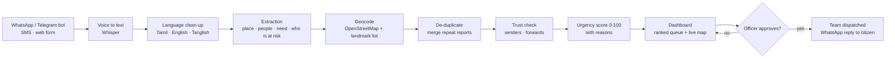

# Architecture

## Stage by stage

| Stage | Purpose | In this repo today | Planned |
|---|---|---|---|
| Intake | Get messages in from people on weak networks | `POST /messages` API | WhatsApp Cloud API / Telegram bot, SMS gateway |
| Voice to text | Handle voice notes | not built | Whisper |
| Extraction | Turn free text into structured facts | `extract.py` (rules: English, Tanglish, some Tamil script) | LLM extractor returning the same `Extraction` object |
| Geocoding | Put reports on a map | `gazetteer.py` (14 Chennai localities, approximate) | OpenStreetMap Nominatim + landmark list |
| De-duplication | One incident = one card | `dedup.py` (same place + street + time window + wording) | multilingual embeddings (LaBSE) + geo-time clustering |
| Trust | Limit rumours | `pipeline.py` (sender count, chain-forward detection) | source reputation, cross-checks with official alerts |
| Urgency score | Rank by who needs help first | `score.py` (explainable, example weights) | weights tuned with disaster-management officers |
| Dashboard | Show the ranked queue on a map | concept image only | React + Leaflet, nearest-team routing (OSRM) |

## Design decisions

* **Explainable first.** Every point in the urgency score has a written reason, so an officer can trust or override it.
* **Human in the loop.** The system ranks and suggests. It never dispatches by itself.
* **One interface per stage.** The rule-based extractor and the planned LLM extractor both return `Extraction`, so swapping one for the other touches no other file.
* **Works offline.** The baseline needs no API keys, so the demo and tests run anywhere.
